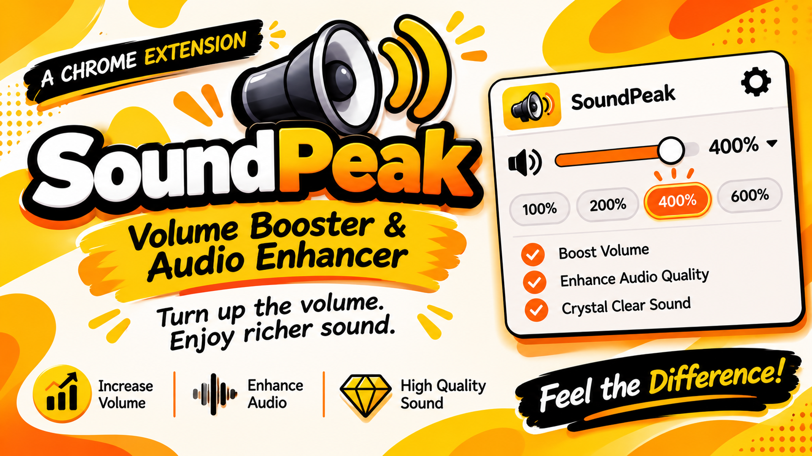

# SoundPeak — Volume Booster & Audio Enhancer

  

A Chrome extension that boosts audio and video volume beyond the normal 100% limit — **up to 600%**.

**Turn up the volume. Enjoy richer sound.**

## Features

- 🔊 Boost volume up to **600%** on pages with audio or video
- 🎚️ Slider control for precise volume adjustment
- ⚡ Quick presets — **100%, 200%, 400%, and 600%**
- 💾 Remembers your volume setting across tabs
- 🔄 Automatically detects dynamically added media elements
- 🎧 Works with both `<audio>` and `<video>` elements

## How It Works

SoundPeak uses the **Web Audio API** to amplify media audio beyond the browser's standard volume limit.

A content script detects audio and video elements on the page and routes their audio through a `GainNode`, allowing SoundPeak to increase the output level beyond 100%.

## Installation

1. Open `chrome://extensions/` in Chrome.
2. Enable **Developer mode** in the top-right corner.
3. Click **Load unpacked**.
4. Select the **SoundPeak** directory.
